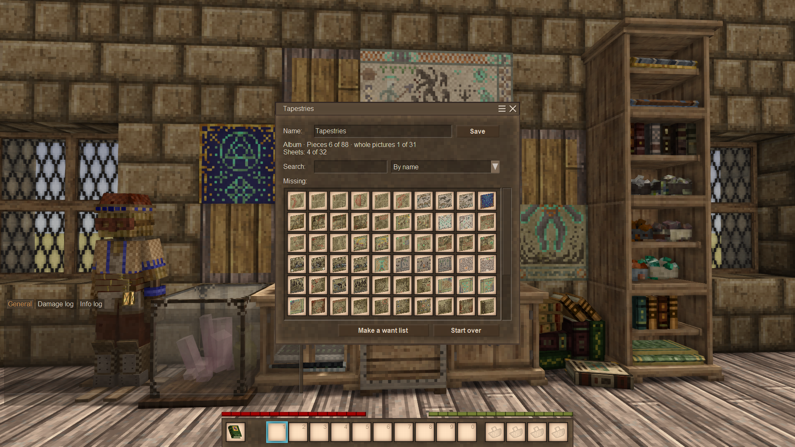

# Curio Catalogue

A Vintage Story mod about collecting and keeping account of things, in the spirit of an old counting house.

> **Early development.** This is 0.1.1, still a minimal version of the mod (an MVP). **Back up your world** before installing
> it or a new version of it.



## For players

- Download: [Vintage Story ModDB](https://mods.vintagestory.at/curiocatalogue).
- How to start, gestures, collections, configuration, compatibility: the guide, [in English](docs/guide/README.md) and
  [українською](docs/guide/README.uk.md).
- What the mod is, in short: the description,
  [in English](docs/moddb/description.md) and [українською](docs/moddb/description.uk.md). The ModDB page is generated from it.

## What may come next

Not promised, roughly in this order (details in [ROADMAP.md](ROADMAP.md)):

- albums that also see what is on display (walls, shelves, display cases), not only what lies in chests;
- recipes put into a bill of materials;
- collections of your own.

## Building and tests

- Set up a machine with [docs/onboarding.md](docs/onboarding.md): .NET 10 SDK, a separate copy of the game, environment variables.
- Build: `dotnet build curiocatalogue.sln`; tests: `dotnet test curiocatalogue.sln`. Day-to-day work, launch profiles and tools:
  [docs/development.md](docs/development.md).
- [CLAUDE.md](CLAUDE.md) is the map of the documentation: for each document, when to read it and when to update it.

## Adding a collection

Another mod can bring its own collection for the album, with no change to ours: a definition (a JSON asset), the lang entries
it names, and, to make its album, a crafting recipe. The members come from a *source* (a kind of rule written in our code), and
everything else (dimensions, levels, layouts, icons) is data. The reasons for the shape are in
[docs/decisions.md](docs/decisions.md), "Collections".

Two things first:

- **The mod must be `"side": "Universal"` and required on the client.** The server tells clients only the player's settings
  for the collection (`Collections` in the config), not the definitions: each client reads them from its own assets. A patch
  of a definition (an admin's, or yours) must not be `"side": "server"` either, or the client does not know the collection.
- **A definition that does not read is skipped, and the log says why.** Look for `Curio Catalogue` errors in `server-main.log`
  and `client-main.log`; the other collections keep working.

### The definition

The file is `assets/<yourdomain>/config/curiocatalogue/collections/<id>.json`; the **id** is the file's name (without `.json`).
It is the key of the collection in the config and in the albums players have made, so do not change it later. Two mods with
the same id: the one of `curiocatalogue` wins, then the game's asset order; the others are logged as errors.

| Field | Needed | What it is |
|---|---|---|
| `source` | yes | Where the members come from; see "Sources" below. |
| `dimensions` | yes | The axes a member is described by (a seashell's `type` and `color`). A list of objects, below. |
| `levels` | yes | The ways to look at the collection, at least one: which dimensions are kept, which dropped. Below. |
| `nameKey` | no | The collection's name in lower case, a lang key (`yourmod:collection-shells`): "Album: {0}". |
| `albumRecipe` | no | The grid recipe that makes the album, by name with its domain: `yourmod:ledger-album-shells`. |
| `exclude` | no | Names of members to leave out (what a source gives, e.g. `crystalizedore-*-uranium-*` for `variants`). |
| `rules` | no | `{ "where": { dimension: [values] }, "set": { attribute: "text" } }`: attributes of members by their values. |
| `marks` | no | `{ attribute: { value: { "color": "#RRGGBB" or "#AARRGGBB", "nameKey": … } } }`: the corner mark and the tooltip line, in that colour, of a member with that attribute (the first that fits). |

**Sources** (`source.kind`):

- `variants`: the registered items and blocks of one code with variant groups. `{ "kind": "variants", "code":
  "game:seashell-{type}-{color}" }`: each `{name}` is a dimension named so and takes the text between dashes, so the members
  follow the loaded game and mods. A code with a name twice, or a name that is not a letter followed by letters, digits or `_`,
  is refused.
- `tapestry`: the pieces of a block's `sizes` attribute. `{ "kind": "tapestry", "block": "game:tapestry-north" }`; the
  dimensions are `picture`, `piece` and `section`, and the pieces' places are `x` and `y`. A collection of this source is named
  by the game (`game:tapestry-{value}`) wherever it has a `piece` dimension, whatever its id.

A collection whose source finds nothing (no such items: your mod's collection without your mod) is simply not shown.

**Dimensions** (each object of `dimensions`):

| Field | Needed | What it is |
|---|---|---|
| `code` | yes | The dimension's name; for `variants`, the `{name}` in the source's code. |
| `values` | no | The values in the order to show. The game keeps no order of variants, so list them; a value the source finds but the list lacks comes after the listed ones, with a warning. Needed for any dimension a level drops as `"max"`. |
| `nameKey` | no | Lang key of a value's name, with `{value}`: `game:rock-{value}`. |
| `shortNameKey` | no | A shorter name for a table's heading with little room; the full name stays in the tooltip. |
| `anyKey` | no | A phrase in lower case for what a member of several items leaves free ("any colour"). |
| `icon` | no | A value's icon with `{value}`: an item or block code (`game:nugget-{value}`) or an SVG by its path (`yourmod:textures/icons/shell-{value}.svg`). |
| `icons` | no | Value → icon, for the values `icon` does not fit; alone it makes a whole table's headings. |
| `from`, `map` | no | A derived dimension: `from` names an earlier dimension, `map` gives each value its source values (value → list). For grouping only; never part of a member's name. A source value in two entries is refused; one the `map` lacks is its own value, with a warning. |

An SVG is drawn in its own colours. An icon the game does not have (a removed mod's item, a missing file) is not an error: the
window shows the name alone.

**Levels** (each object of `levels`): `id`, `keep` (the dimensions that tell members apart at this level), `drop` (for every
dimension not kept: `"any"`, any of its values fills the member, or `"max"`, only the highest value that occurs fills it).
Every dimension must be either kept or dropped; a collection with one level shows no choice. Optional: `nameKey` (the level in
the album's choice), `icon` (as a dimension's, with no `{value}`), `progressKey` (the whole line of progress, `{0}` collected,
`{1}` of all, `{2}` groups complete, `{3}` groups), `memberKey` (a member's whole name, `{0}`, `{1}`… the parts of its name,
with what it leaves free written in the text), and `layouts`. Write texts in each language's grammar, in your own lang files.

**Layouts** (each object of a level's `layouts`; the first is the default): `id`, `groupBy` (the dimensions that make
groups), `arrange` and optionally `nameKey` and `icon`. `arrange` is `{ "kind": "table", "rows": dimension, "columns": dimension
}` (with `"reverseRows": true` the highest row first), `{ "kind": "shape" }` (by the members' `x` and `y`, for tapestries) or
`{ "kind": "order" }` (the default). Taking new items follows the default layout's order.

### The album recipe

An album is made in the crafting grid from an empty ledger or bill of materials and any one member of the collection (which
stays). For your collection, bring a grid recipe like ours (`recipes/grid/ledger.json` of this mod, `ledger-album-crystals`),
with your member item for `C` (`isTool` with no durability cost keeps it) and the `name` you wrote in `albumRecipe`:

```json
{
  "ingredientPattern": "LC",
  "ingredients": {
    "L": { "type": "item", "code": "curiocatalogue:book-{kind}-{cover}" },
    "C": { "type": "item", "code": "game:seashell-*", "isTool": true, "toolDurabilityCost": 0 }
  },
  "allowedVariants": {
    "kind": ["ledger", "materials"],
    "cover": ["normal-brickred", "normal-cherryred", "…the rest of the covers, as in ours"]
  },
  "width": 2,
  "height": 1,
  "shapeless": true,
  "name": "yourmod:ledger-album-shells",
  "recipeGroup": 4,
  "copyAttributesFrom": "L",
  "output": { "type": "item", "code": "curiocatalogue:book-album-{cover}" }
}
```

The member in the grid must belong to the collection, or the recipe gives nothing. A player can switch the collection off in
the config (`Collections.<id>.Disabled`): then its album recipe is removed from the game at load.

### Examples and checks

- [`tapestries.json`](curiocatalogue/assets/curiocatalogue/config/curiocatalogue/collections/tapestries.json): the smallest of
  ours; `crystals.json` has levels, tables, icons and layouts, `butterflies.json` a derived dimension, `seashells.json` marks.
- [`CurioCatalogue.CompatTests/testmods/cccollections`](CurioCatalogue.CompatTests/testmods/cccollections): a small mod that
  brings collections and patches one, the way yours would (our tests load it into a game server).
- Players and admins can change a collection by the config (`Collections.<id>`: `Exclude`, `Add`, `Disabled`) and you or an
  admin by a JSON patch of the definition (`"file": "yourmod:config/curiocatalogue/collections/<id>.json"`).

## Contributing

Bug reports, ideas, code and translations are welcome: see [CONTRIBUTING.md](CONTRIBUTING.md). What may come next:
[ROADMAP.md](ROADMAP.md). How the mod is made, by a human and by AI: "AI and human work" in the
[description](docs/moddb/description.md#ai-and-human-work).

## License

MIT, except a few files derived from Vintage Story: see [LICENSE](LICENSE).
