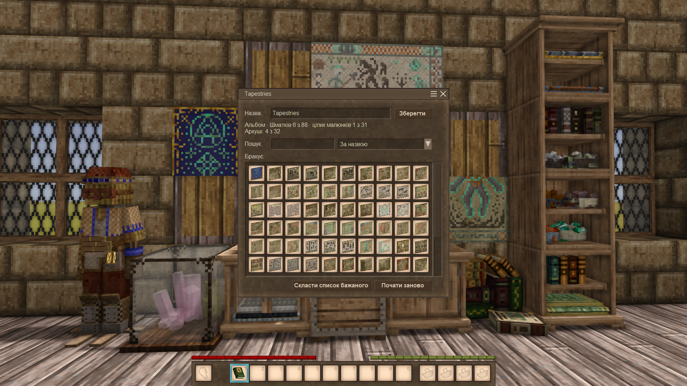
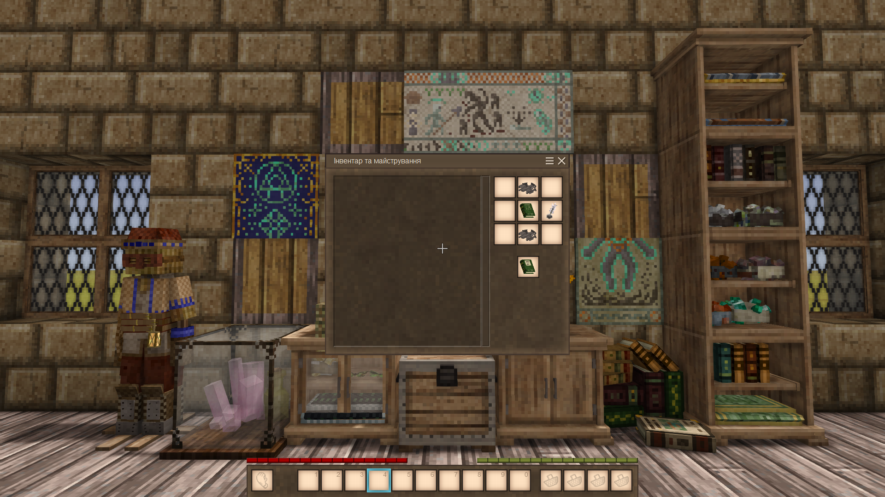
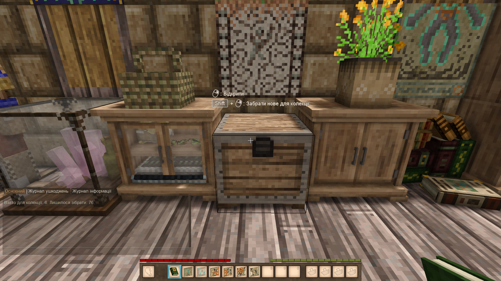
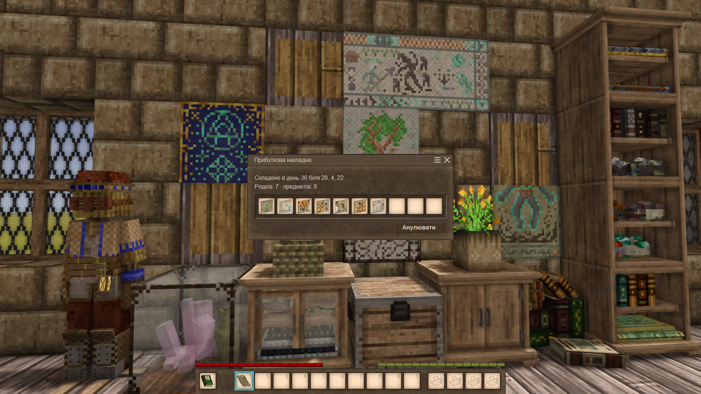

# Каталог дивовиж

Мод для Vintage Story про колекціонування й облік речей у дусі старої контори.

English: [README.md](README.md).

Завантажити: [Vintage Story ModDB](https://mods.vintagestory.at/curiocatalogue).

> **Рання стадія розробки.** Це 0.1.1, ще мінімальна версія мода (MVP). Спершу спробуйте його в тестовому світі.
> Спосіб, у який книги й накладні зберігають дані, може змінитися в наступних двох релізах, і книги та накладні, зроблені цією
> версією, можуть не перейти на нову.
>
> **Зробіть резервну копію світу** перед встановленням мода чи його нової версії.

## Що всередині

- **Альбом:** каталог колекціонера, що знає, чого вам ще бракує, і забирає зі скрині по одному примірнику кожного відсутнього шматка. Чотири колекції: гобелени (88 шматків, 31 малюнок), кристали руди, мушлі (42) і метелики (169); див. «Колекції» нижче.
- **Список бажаного:** складається в альбомі; віддайте його другові, і він збере зі скринь друга те, чого вам бракує.
- **Облікова книга:** книга, що записує, які предмети є, за видами.
- **Список матеріалів:** книга, що записує, скільки кожного; список покупок для будівництва, що скорочується, поки ви берете потрібне зі скринь.
- **Прибуткова накладна:** те, що є в скрині, а в книзі немає; проведіть її по скрині, і предмети перейдуть у ваш інвентар.
- **Видаткова накладна:** те, що є в скрині з записаного в книзі; переносить усе або нічого.

Книги й накладні — звичайні предмети. Вони самі зберігають свої дані, тож їх можна передати, поставити на полицю чи загубити.

### Чого він не робить

- **Жодного віддаленого доступу й мережі сховищ.** Предмети переносяться лише там, де ви стоїте: ви йдете до скрині, натискаєте її й бачите, як предмети переходять.
- **Жодного автоматичного сортування.** Ви вирішуєте, що куди йде; книги допомагають бачити й переносити.
- **Жодних цін.** Торгівля лишається між гравцями; мод лише робить перенесення речей легшим і відчутнішим.

### Що може бути далі

Не обіцяно, приблизно в такому порядку (подробиці в `ROADMAP.md`, англійською):

- альбоми, що бачать і виставлене (на стінах, полицях, у вітринах), а не лише те, що лежить у скринях;
- рецепти, що потрапляють у список матеріалів;
- власні колекції.

### Схожі моди

«Каталог дивовиж» — про колекції, які ви зберігаєте й носите в руках: книги й накладні — предмети, ви йдете до скрині й бачите, як предмети переходять. Інші моди дещо перетинаються з ним; якщо котрийсь вам підходить більше, користуйтеся ним.

- **[Infinitum Collections](https://mods.vintagestory.at/infinitumcollections)** від unicorn_ares — журнал відкриттів (риби, гриби,
  метелики) з посиланнями на довідник. Альбом Curio Catalogue веде облік того, що ви справді зберігаєте, у скринях чи на виставці,
  і бере звідти те, чого бракує. Ще він робить списки бажаного для інших гравців.
- **[Bookkeeper](https://mods.vintagestory.at/show/mod/43155)** і **[Quartermaster](https://mods.vintagestory.at/show/mod/57459)**
  від Feyd керують сховищами: шукають предмети в сусідніх контейнерах, а Quartermaster ще й бере та складає їх віддалено. Їх
  цікавить, що лежить у сховищах, а не чого бракує колекції.

Дякуємо цим авторам: їхня праця робить спільноту модів гри багатшою.

## Як почати

1. **Перша книга.** Ванільна книга посередині сітки крафту, цвяхи й смуги над і під нею, перо з чорнилом праворуч: облікова книга
   з 8 аркушами й обкладинкою тієї книги. Написане в тій книзі пропаде. Велику книгу, знайдену в руїнах, можна відновити глечиком
   вапняної води й пером з чорнилом: така книга має 32 аркуші.

   

2. **Альбом.** Порожня облікова книга й будь-який предмет колекції (шматок гобелена, кристал руди, мушля, мертвий метелик)
   в сітці крафту; предмет лишається. Який предмет ви взяли, така й колекція альбому.
3. **Збирайте.** Тримайте альбом у руці або в другій руці, коли основна порожня, і натисніть **Shift + ПКМ** по скрині.
4. **Дивіться.** ПКМ у повітря відкриває альбом сторінками: кожен малюнок зі своїми шматками на місцях, наявні й бракуючі
   тьмяними силуетами. Гортайте сторінки кнопками або оберіть групу на вкладці; пошук підсвічує збіги. Під заголовком: назва
   альбому (олівець змінює її), смуга зібраного й аркуші, що лишилися для списків бажаного. Кнопка **Скласти список
   бажаного** стоїть у ряду керування.

У довіднику гри є посібник «Каталог дивовиж» і сторінка для кожної книги.

## Колекції

Альбом збирає одну колекцію, яку визначає предмет, з якого його зроблено. Де в колекції є рівні, ви обираєте рівень у вікні
альбому, поки той порожній; перший забраний предмет закріплює його, а «Почати заново» звільняє.

| Колекція | Робиться з | Рівні |
|---|---|---|
| Гобелени | шматок гобелена | один: 88 шматків у 31 малюнку |
| Кристали руди | кристал руди | найбагатший кристал кожної руди (16); кожна руда в кожній породі (118); усі кристали (353) |
| Мушлі | мушля | кожен вид у будь-якому кольорі (7); кожен вид у кожному кольорі (42) |
| Метелики | мертвий метелик | один: усі 169, показані за родинами й видами (109) або за рідкістю |

- Список бажаного каже, чого бракує, а не один предмет: де згодиться кілька предметів (мушля будь-якого кольору, кристал у
  будь-якій породі), там написано «будь-якого кольору» чи «будь-яка порода», і береться той, для якого є місце. Кожен рядок
  називає те, чого бракує, тим, що воно є («Засідка, ліва третина», «Самородна мідь, базальт»), і так само підказка над
  клітинкою альбому.
- Метелики на полицях, у вітринах і в модах-вітринах поки не зчитуються: спершу покладіть їх у скриню. Те саме з гобеленами
  на стіні.

## Жести

З книгою в руці або в другій руці, коли основна порожня:

- **Shift + ПКМ** по контейнеру: альбом забирає нове для колекції; облікова книга чи список матеріалів складає прибуткову накладну
  на те, чого в книзі немає.
- **Shift + Ctrl + ПКМ** по контейнеру: видаткова накладна на те, що в книзі є.
- **ПКМ у повітря:** відкриває книгу.

З накладною в руці **Shift + ПКМ** по будь-якому контейнеру проводить її. Якщо книга в другій руці, вона оновиться й отримає
аркуш назад (альбом лише забирає аркуш); без неї накладна стане пергаментом. Список бажаного проводиться так само: забирає те,
що в ньому є, а виконаний стає пергаментом.

Звичайні ПКМ і Ctrl + ПКМ відкривають контейнери, як завжди.

## Чесна гра на серверах

- Вирішує сервер. Накладна переносить усе, що в ній записано, або нічого, і каже, що завадило.
- Доступу не більше, ніж руками: приватні зони, замки й укріплення діють на кожну дію, як на відкриття скрині.
- Жодного віддаленого доступу: предмети переносяться лише з того контейнера, по якому ви натиснули.

## Налаштування

`ModConfig/curiocatalogue.json`:

- `MaxSheets` (32): скільки аркушів уміщує книга.
- `SoftEntryLimit` (500): книга з такою кількістю записів більше не складає прибуткових накладних.
- `ConsumeSheets` (false): хардкор; проведена накладна ніколи не повертає аркуш.
- `ExtraIgnoredAttributes` (`["durability"]`): атрибути, які не враховуються при порівнянні предметів, на додачу до ігрових.
- `Collections`: налаштування кожної колекції за її id (`tapestries`): `Exclude` (назви, які прибрати, `*` — довільний текст, напр. `["aid-*"]` для шматків гобеленів), `Add` (додаткові шматки гобеленів з інших модів) і `Disabled` (вимкнути колекцію). Старі `TapestryExclude` і `TapestryAdd` з 0.1 переїжджають туди самі під час першого запуску.
- `Diagnostics` (false): писати подробиці в журнал гри, щоб шукати проблеми.

Сервер надсилає свої `Collections` і `ExtraIgnoredAttributes` кожному клієнтові під час входу, тож альбом і підказки слідують файлу сервера, а не клієнта. Решту налаштувань застосовує лише сервер. Мод, що додає колекцію, має стояти на сервері й на кожному клієнті: означення читаються з власних ресурсів кожної сторони.

## Сумісність і відомі обмеження

- Потрібна Vintage Story 1.22.7. Встановіть мод на сервер і на кожен клієнт.
- Моди, що додають гобелени до ігрового списку гобеленів, альбом підхоплює.
- Перевірено з Upgradeable Storage і Carry On.
- **Better Crates** не підтримується: його ящики відмовляють нашим накладним і показують накладні й книги неправильно (темними, розвернутими).
- Наші книги й накладні не кладуться у ванільний ящик: Shift + ПКМ по контейнеру — наш жест.
- З увімкненим `ConsumeSheets` слова довідника «аркуш повертається» не діють.
- Підтримувані контейнери: скрині, великі дерев'яні скрині, скрині з табличкою, кошики, посудини для зберігання, ящики, рюкзаки
  й кошики, поставлені на землю, а також скрині інших модів, зроблені на основі ванільних. На інші блоки з інвентарем (печі,
  бочки, полиці…) мод каже «Цей контейнер поки не підтримується». Персональні скрині зі здобиччю в руїнах відмовляють.
  Якщо так каже контейнер іншого мода, напишіть нам назву мода й блоку: див. `CONTRIBUTING.md`.

## Видалення мода

Гра видаляє предмети мода, якого вже немає. Без «Каталогу дивовиж» усі книги й накладні зникнуть з інвентарів і скринь разом
з аркушами в них; повторне встановлення мода їх не поверне.

## Мови

Англійська й українська. Переклади вітаються: див. `CONTRIBUTING.md` (англійською).

## Участь

Звіти про помилки, ідеї, код і переклади: див. `CONTRIBUTING.md`. Що може бути далі: див. «Що всередині» вище й `ROADMAP.md`.

## ШІ та людина

- **Напрямок:** людина. DankoSedin вирішує, що це за мод, що він робить і чого не робитиме.
- **Код:** пише ШІ (Claude, Anthropic) у рамках тестів і документації.
- **Тексти й переклад:** усе, що читає гравець, англійською та українською, пише ШІ під пильним наглядом людини.
- **Асети:** текстури предметів намальовані скриптом; форма книги й іконка мода створені на основі асетів самої гри.

## Автори й подяки

- Дякуємо Anego Studios за Vintage Story і за відкритий код її API та модуля виживання: з нього ми дізналися, як працює гра.
- Дякуємо [серверу Fendragon](https://discord.gg/2yNGvKcRP), де автор збирає ті самі гобелени, для яких зроблено цей мод.
- Дякуємо Jeff Walker за [ExhaustiveMatching](https://github.com/WalkerCodeRanger/ExhaustiveMatching) (BSD-3-Clause): вона перетворює
  пропущений `case` у `switch` на помилку компіляції. Вона потрібна лише під час збирання; у зіпі мода її коду немає.

## Ліцензія

MIT, крім кількох файлів, похідних від Vintage Story: див. `LICENSE`.
