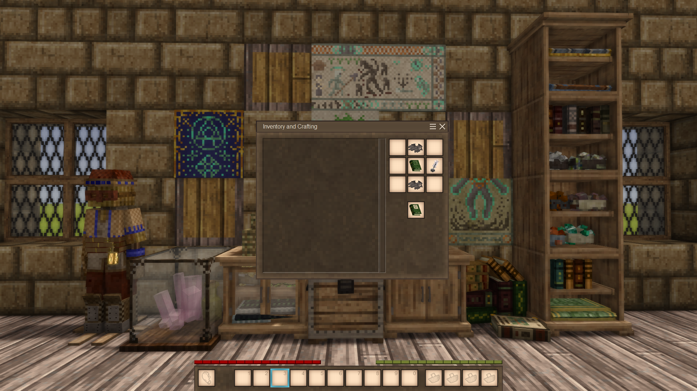
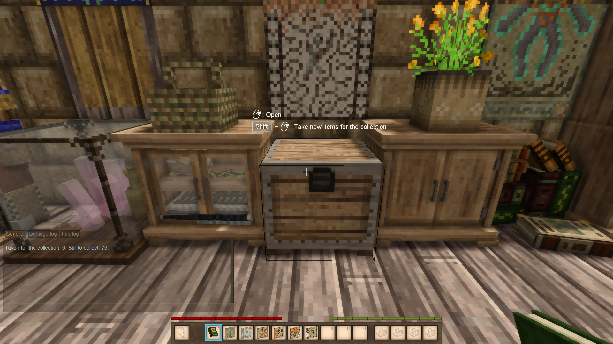
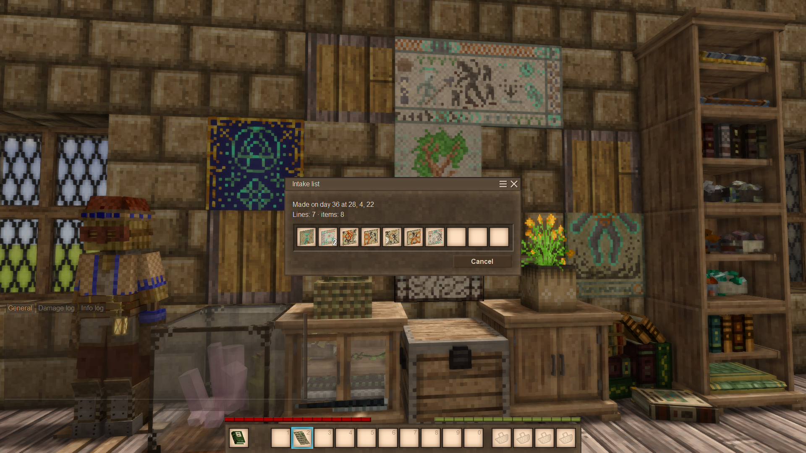

# Curio Catalogue: the guide

The full guide to the mod: every gesture, recipe, collection and setting. The short story is on the
[ModDB page](https://mods.vintagestory.at/curiocatalogue); a shorter guide for playing is in the game's handbook. Ukrainian: [README.uk.md](README.uk.md).

Contents: [Getting started](#getting-started), [Collections](#collections), [Gestures](#gestures),
[Fair play on servers](#fair-play-on-servers), [Configuration](#configuration),
[Compatibility and known limitations](#compatibility-and-known-limitations), [Removing the mod](#removing-the-mod),
[Sheets and covers](#sheets-and-covers).

## Getting started

1. **Your first book.** A vanilla book in the middle of the crafting grid, nails and strips above and below it, ink and quill to
   its right: a ledger with 8 sheets and the cover of the book you used. Anything written in that book is lost. A large book found
   in ruins can be restored with a jug of lime water and ink and quill: that ledger has 32 sheets.

   

2. **The album.** An empty ledger and any piece of the collection (a tapestry piece, an ore crystal, a seashell, a dead butterfly)
   in the crafting grid; the piece stays. The piece you use decides the collection.
3. **Collect.** Hold the album, or keep it in your off-hand with the main hand empty, and press **Shift + right click** on a chest.
4. **Look.** Right click into the air opens the album as pages: every picture with its pieces in place, the ones you have
   and the missing ones as dim silhouettes. Turn the pages with the buttons, or pick a group on its tab; a search lights the
   matches. Under the title: the album's name (click the pencil to change it), a bar with how much is collected, and the sheets
   left for want lists. The **Make a want list** button is in the row of controls.

The in-game handbook has a Curio Catalogue guide and a page for every book.

## Collections

An album collects one collection, chosen by the piece it is made from. Where a collection has levels, you choose one in the
album window while the album is empty; the first piece taken fixes it, and "Start over" frees it.

| Collection | Made from | Levels |
|---|---|---|
| Tapestries | a tapestry piece | one: 88 pieces in 31 pictures |
| Ore crystals | an ore crystal | the richest crystal of each ore (16); each ore in each rock (118); every crystal (353) |
| Seashells | a seashell | every type in any colour (7); every type in every colour (42) |
| Butterflies | a dead butterfly | one: all 169, shown by family and species (109) or by rarity |

- A want list says what is missing, not one item: where several items will do (a seashell of any colour, a crystal in any rock)
  it says "any colour" or "any rock" and takes whichever there is room for. Each line names what is missing by what it is
  ("Ambush, left third", "Native copper, basalt"), and so does the album's tooltip over a cell.
- Butterflies on shelves, in display cases and in display mods are not read yet: take them into a chest first. The same holds for
  tapestries on a wall.

## Gestures

With a book in hand, or in your off-hand with the main hand empty:

- **Shift + right click** on a container: the album takes what is new for the collection; a ledger or a bill of materials makes an
  intake list for what the book lacks.
- **Shift + Ctrl + right click** on a container: a pick list for what the book lists.
- **Right click into the air:** opens the book.

With a list in hand, **Shift + right click** on any container fills it. With a book in your off-hand the book is updated and
the sheet comes back (an album only takes the sheet); without one the list becomes parchment. A want list is filled the same
way: it takes what it lists, and a finished one becomes parchment.

Plain right click and Ctrl + right click open containers as usual.

## Fair play on servers

- The server decides. A list moves everything it lists or nothing, and says what stopped it.
- No more access than by hand: land claims, padlocks and reinforcement apply to every action, as to opening the chest yourself.
- No remote access: items move only from the container you click.

## Configuration

`ModConfig/curiocatalogue.json`:

- `MaxSheets` (32): sheets a book can hold.
- `SoftEntryLimit` (500): a book with this many entries makes no more intake lists.
- `ConsumeSheets` (false): hardcore; a filled list never gives its sheet back.
- `ExtraIgnoredAttributes` (`["durability"]`): attributes ignored when comparing items, on top of the game's own.
- `Collections`: settings per collection, by its id (`tapestries`): `Exclude` (names to leave out, `*` for any text, e.g. `["aid-*"]` for tapestry pieces), `Add` (extra tapestry pieces of other mods) and `Disabled` (switch the collection off). The old `TapestryExclude` and `TapestryAdd` of 0.1 move there by themselves on the first start.
- `Diagnostics` (false): write details to the game log, for finding problems.

The server sends its `Collections` and `ExtraIgnoredAttributes` to every client when it joins, so the album and the tooltips follow the server's file, not the client's. The other settings the server alone acts on. A mod that brings a collection must be on the server and on every client: the definitions are read from each side's own assets.

## Compatibility and known limitations

- Needs Vintage Story 1.22.7. Install it on the server and on every client.
- Mods that add tapestries to the game's tapestry list are picked up by the album.
- Tested with Upgradeable Storage and Carry On.
- **Better Crates** is not supported: its crates refuse our lists, and show lists and books wrongly (dark, turned around).
- Our books and lists do not go into a vanilla crate: Shift + right click on a container is ours.
- With `ConsumeSheets` on, the handbook's "the sheet comes back" does not apply.
- Supported containers: chests, trunks, labeled chests, stationary baskets, storage vessels, crates, backpacks and baskets placed on
  the ground, and other mods' chests built on the vanilla ones. On other blocks with an inventory (ovens, barrels,
  shelves…) the mod says "This container is not supported yet". Per-player loot chests in ruins are refused.
  If a container of another mod says so, tell us the mod and the block: see [CONTRIBUTING.md](../../CONTRIBUTING.md).

## Removing the mod

The game deletes items of a removed mod. Without Curio Catalogue, every book and list disappears from inventories and chests,
with the sheets in them; installing the mod again does not bring them back.

## Sheets and covers

Each intake list, pick list and want list costs a sheet. Any of them can be cancelled in its window: no items move, and its sheet
goes back into the book in your off-hand; without one it becomes parchment. Add sheets with parchment in the crafting grid, up to
the limit (32 by default). Dyed leather recolours a book, and a jug with sulfuric acid ages its cover.
