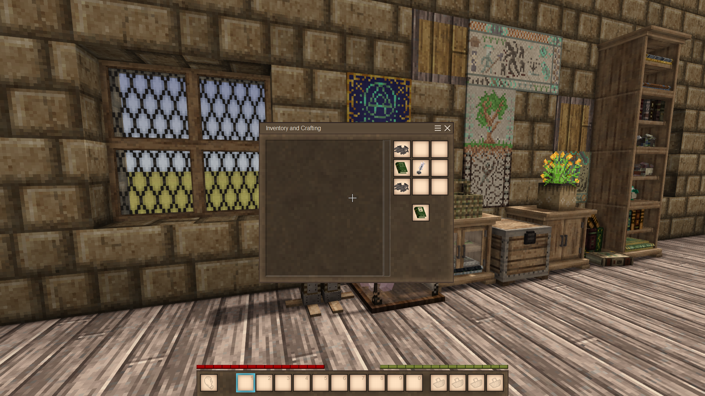
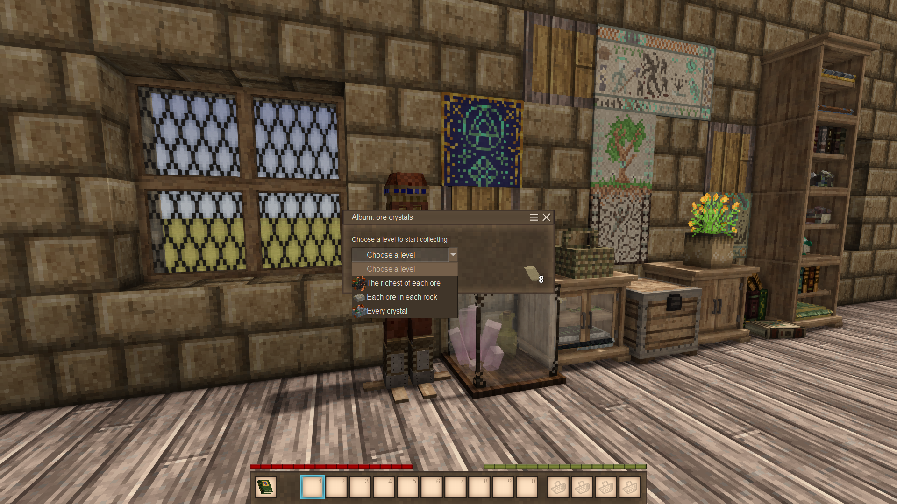
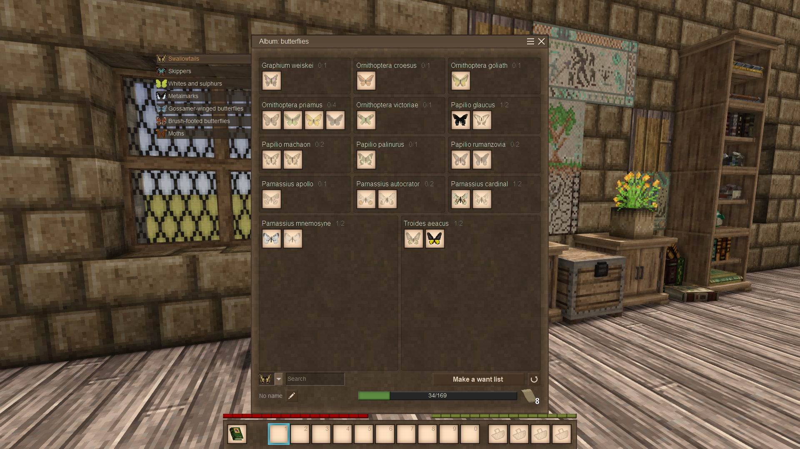
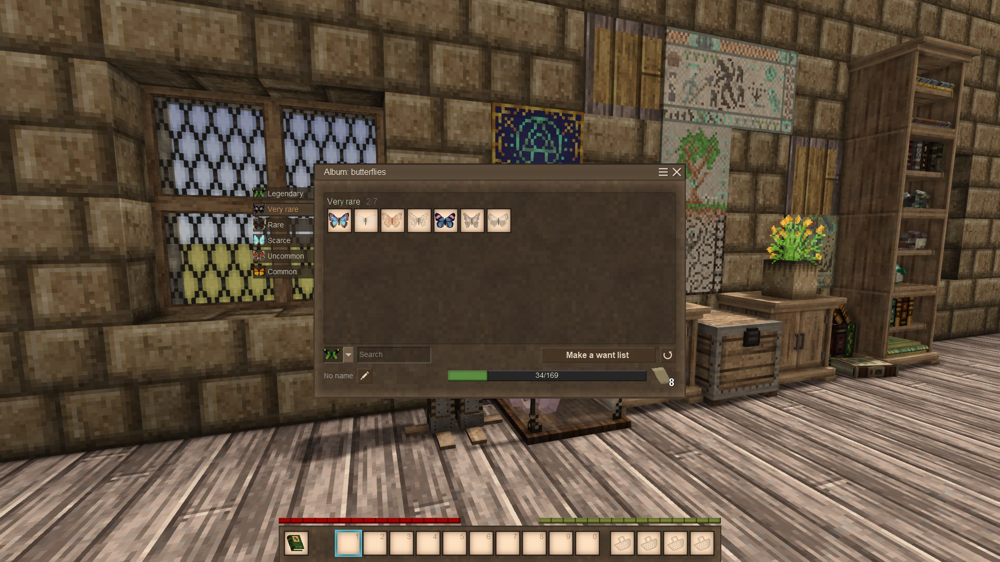
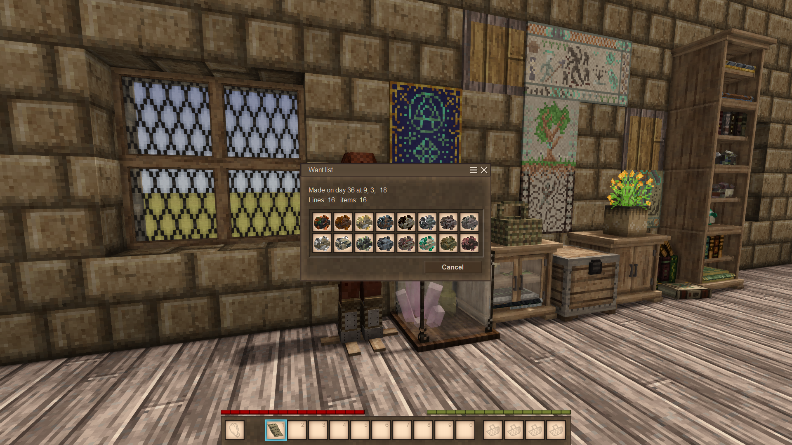
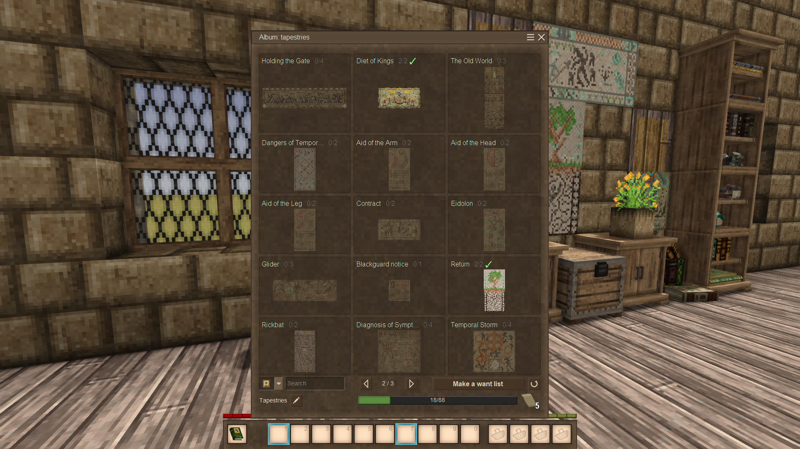
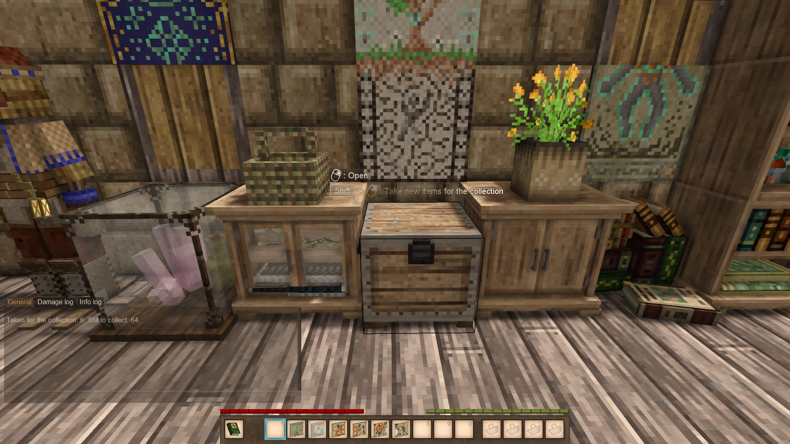
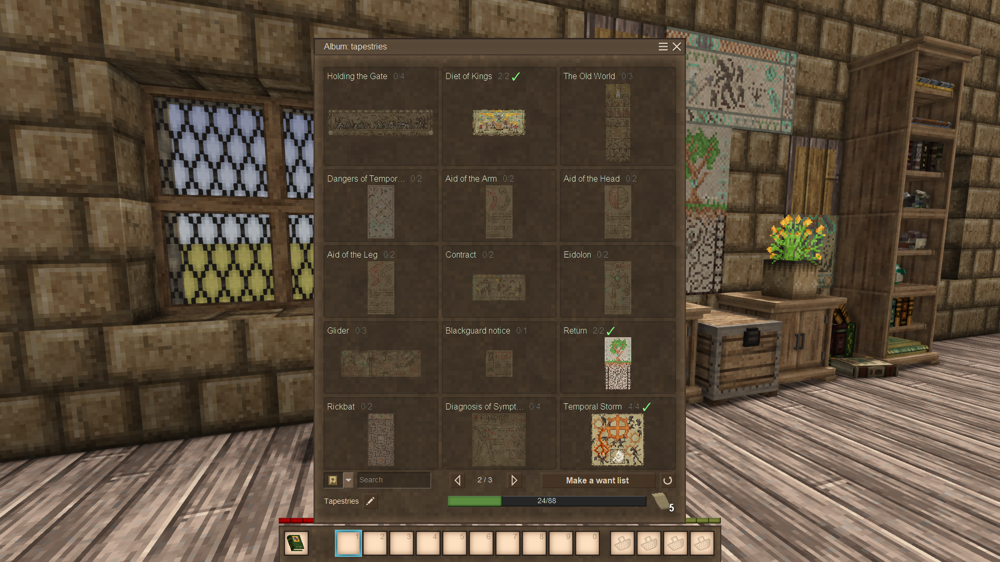
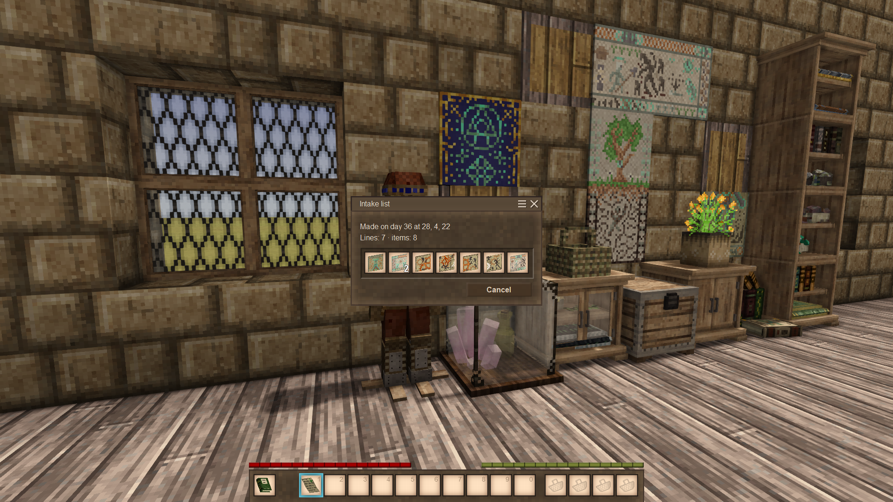

# Curio Catalogue: the guide

The full guide to the mod: every gesture, recipe, collection and setting. The short story is on the
[ModDB page](https://mods.vintagestory.at/curiocatalogue); a shorter guide for playing is in the game's handbook. Ukrainian: [README.uk.md](README.uk.md).

Contents: [Getting started](#getting-started), [Collections](#collections), [Gestures](#gestures),
[Fair play on servers](#fair-play-on-servers), [Configuration](#configuration),
[Compatibility and known limitations](#compatibility-and-known-limitations), [Removing the mod](#removing-the-mod),
[Sheets and covers](#sheets-and-covers).

## Getting started

1. **Your first book.** A vanilla book in the middle of the crafting grid, nails and strips above and below it, ink and quill to
   its right: a ledger with 8 sheets and the cover of the book you used. Anything written in that book is lost. A large book found
   in ruins can be restored with a jug of lime water and ink and quill: that ledger has 32 sheets. A ledger notes kinds of items, a bill of materials their counts; an empty one
   alone in the crafting grid turns into the other. Their handbook pages tell how they work.

   

2. **The album.** An empty ledger or bill of materials and any piece of the collection (a tapestry piece, an ore crystal, a seashell, a dead butterfly)
   in the crafting grid; the piece stays. The piece you use decides the collection.
3. **Collect.** Hold the album, or keep it in your off-hand with the main hand empty, and press **Shift + right click** on a chest.
   The album records what it takes; where the pieces go after that is up to you.
4. **Look.** Right click into the air opens the album as pages: every picture with its pieces in place, the ones you have
   and the missing ones as dim silhouettes. Turn the pages with the buttons, or pick a group on its tab; a search lights the
   matches. Under the title: the album's name (click the pencil to change it), a bar with how much is collected, and the sheets
   left for want lists. The **Make a want list** button is in the row of controls. An album of ore crystals or seashells first
   asks for a [level](#levels).

The in-game handbook has a Curio Catalogue guide and a page for every book.

## Collections

An album collects one collection, chosen by the piece it is made from.

| Collection | Made from | Levels | Shown |
|---|---|---|---|
| Tapestries | a tapestry piece | one: 88 pieces in 31 pictures | by picture or by size |
| Ore crystals | an ore crystal | *The richest of each ore* (16), *Each ore in each rock* (117), *Every crystal* (349) | by level, see [Layouts](#layouts) |
| Seashells | a seashell | *Every type* (7), *Every type in every colour* (42) | by level, see [Layouts](#layouts) |
| Butterflies | a dead butterfly | one: all 169 (109 species) | by family or by rarity |

### Levels

A level is how much of the collection the album asks for. A new album of ore crystals or seashells has none yet: its window
says "Choose a level to start collecting", and until you choose one in the level dropdown, the album takes nothing and makes
no want list. The first piece taken fixes the level; to choose another, press **Start over**, which makes everything missing
again.

- *The richest of each ore:* one crystal of each ore, of its richest quality, from any rock.
- *Each ore in each rock:* each ore in every rock it is found in, of its richest quality.
- *Every crystal:* every quality of each ore in each rock.
- *Every type:* one shell of each type, in any colour.
- *Every type in every colour:* each type in each of its six colours.

### Layouts

A layout is how the album lays its pieces out on the pages. Where a level can be shown in more than one way, the layout
dropdown switches the view at any time; what is collected stays the same.

- Tapestries: **by picture**, a frame for each picture with its pieces in place, or **by size**, the same frames on a tab for
  each picture size, from the smallest: 1×1, 2×1, 1×2, 3×1, 1×3, 2×2, 4×1 (width × height, in pieces).
- Ore crystals: *The richest of each ore* is one page of 16 crystals; *Each ore in each rock* one table of ores by rocks;
  *Every crystal* is shown **by ore**, a table of qualities by rocks for each ore, or **by rock**, a table of qualities by ores for
  each rock.
- Seashells: *Every type* is one page of 7 shells; *Every type in every colour* one table of types by colours. Seafoam and
  turquoise, the game's rare colours, have a small golden corner and "Rare colour" in the tooltip.
- Butterflies: **by family**, seven tabs (the moths as one) with a frame for each of the 109 species, headed by its Latin name,
  or **by rarity**, six tabs by how often the game spawns them, from legendary to common.

The tables are headed by icons: an ore by its nugget, a quality by a round yellow mark that grows and brightens with it, a rock
by its stone, a shell colour by a round swatch. Hover over one for its name. The richest quality is the top row; a blank place
in a table is a crystal the game never generates.

### Names and "any"

The album's tooltip over a cell and every line of a want list name what is missing by what it is: "Ambush, left third" for a
tapestry piece, "Native copper, bountiful, basalt" for a crystal; butterflies keep the game's own names. Where several items
will do, the name says so ("Native copper, any rock", "Scallop, any colour"); the cell shows those items in turn, and the album
or the want list takes whichever there is room for.

Butterflies on shelves, in display cases and in display mods are not read yet: take them into a chest first. The same holds for
tapestries on a wall.

## Gestures

With a book in hand, or in your off-hand with the main hand empty:

- **Shift + right click** on a container: the album takes what is new for the collection; a ledger or a bill of materials makes an
  intake list for what the book lacks.
- **Shift + Ctrl + right click** on a container: a pick list for what the book lists.
- **Right click into the air:** opens the book.

With a list in hand, **Shift + right click** on any container fills it. With a book in your off-hand the book is updated and
the sheet comes back (an album only gets the sheet back); without one the list becomes parchment. A want list is filled the same
way: it takes what it lists, and a finished one becomes parchment.

Plain right click and Ctrl + right click open containers as usual.

## Fair play on servers

- The server decides. An intake or pick list moves everything it lists or nothing, and says what stopped it.
- No more access than by hand: land claims, padlocks and reinforcement apply to every action, as to opening the chest yourself.
- No remote access: items move only from the container you click.

## Configuration

`ModConfig/curiocatalogue.json`:

- `MaxSheets` (32): sheets a book can hold.
- `SoftEntryLimit` (500): a book with this many entries makes no more intake lists.
- `ConsumeSheets` (false): hardcore; a filled list never gives its sheet back.
- `ExtraIgnoredAttributes` (`["durability"]`): attributes ignored when comparing items, on top of the game's own.
- `Collections`: settings per collection, by its id (`tapestries`, `crystals`, `seashells`, `butterflies`): `Exclude` (names to leave out, `*` for any text: a tapestry piece's `type` (not the name the album shows), e.g. `["aid-*"]`, or an item's code without `game:`, e.g. `["crystalizedore-*-uranium-*"]`), `Add` (extra tapestry pieces of other mods) and `Disabled` (switch the collection off: its albums keep what they collected and take nothing until it is on again). The old `TapestryExclude` and `TapestryAdd` of 0.1 move there by themselves on the first start.
- `Diagnostics` (false): write details to the game log, for finding problems.

The server reads the file when it starts.

The server sends its `Collections` and `ExtraIgnoredAttributes` to every client when it joins, so the album and the tooltips follow the server's file, not the client's. The other settings the server alone acts on. A mod that brings a collection must be on the server and on every client: the definitions are read from each side's own assets.

## Compatibility and known limitations

- Needs Vintage Story 1.22.7. Install it on the server and on every client.
- Mods that add tapestries to the game's tapestry list are picked up by the album; ores, seashells and butterflies of other mods are not.
- Tested with Upgradeable Storage and Carry On.
- **Better Crates** is not supported: its crates refuse our lists, and show lists and books wrongly (dark, turned around).
- Our books and lists do not go into a vanilla crate: Shift + right click on a container is ours.
- With `ConsumeSheets` on, the handbook's "the sheet comes back" does not apply.
- Supported containers: chests, trunks, labeled chests, stationary baskets, storage vessels, vanilla crates, backpacks and baskets placed on
  the ground, and other mods' chests built on the vanilla ones. On other blocks with an inventory (ovens, barrels,
  shelves…) the mod says "This container is not supported yet". Per-player loot chests in ruins are refused.
  If a container of another mod says so, tell us the mod and the block: see [CONTRIBUTING.md](../../CONTRIBUTING.md).

## Removing the mod

The game deletes items of a removed mod. Without Curio Catalogue, every book and list disappears from inventories and chests,
with the sheets in them; installing the mod again does not bring them back. To stop one collection only, switch it off with `Disabled`.

## Sheets and covers

Each intake list, pick list and want list costs a sheet. Any of them can be cancelled in its window: no items move, and its sheet
goes back into the book in your off-hand; without one it becomes parchment. Add sheets with parchment in the crafting grid, up to
the limit (32 by default). Dyed leather recolours a book, and a jug with sulfuric acid ages its cover.
