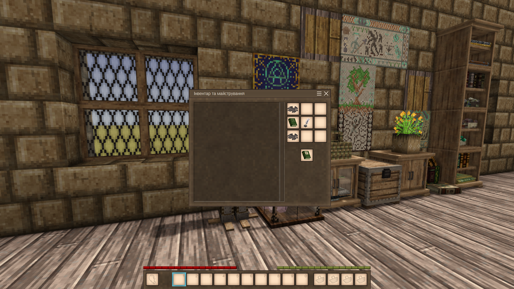
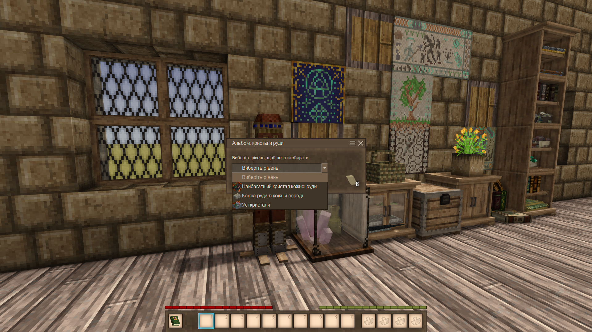
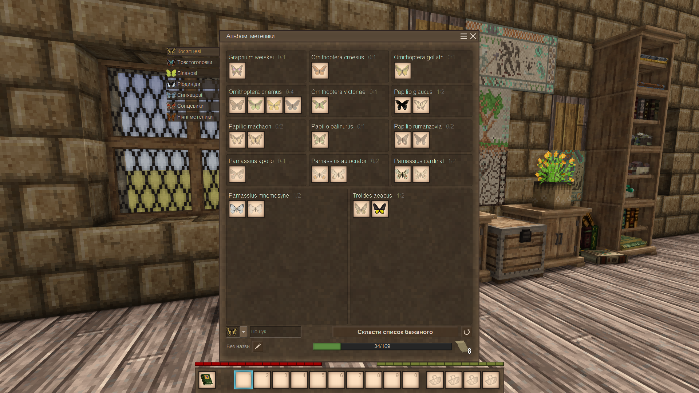
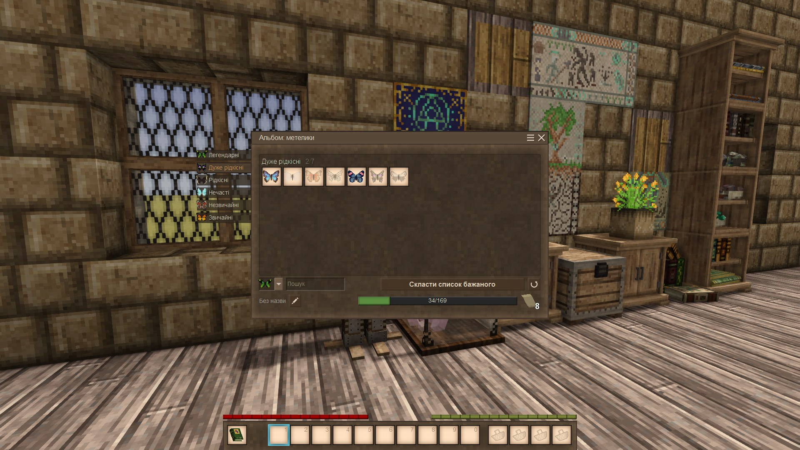
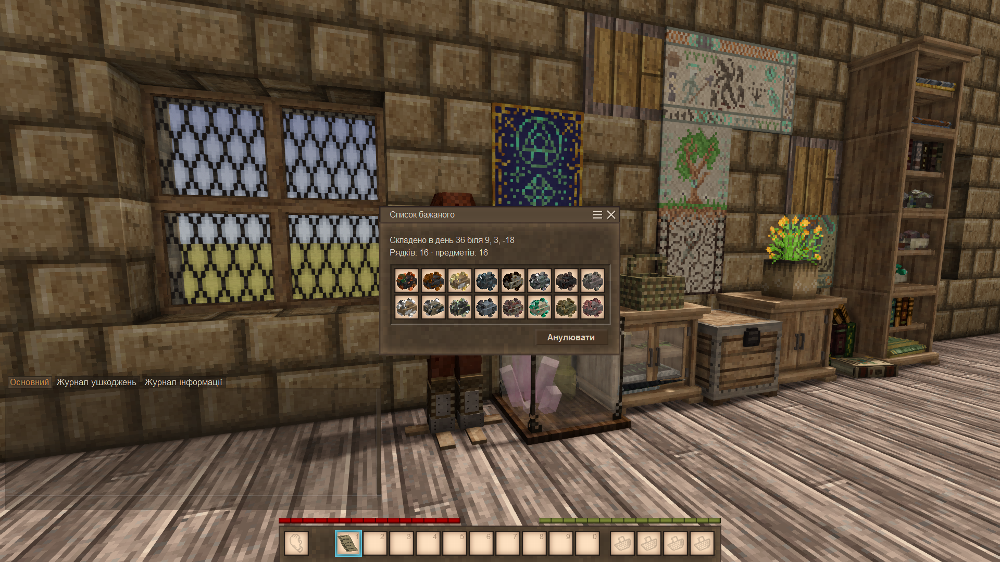
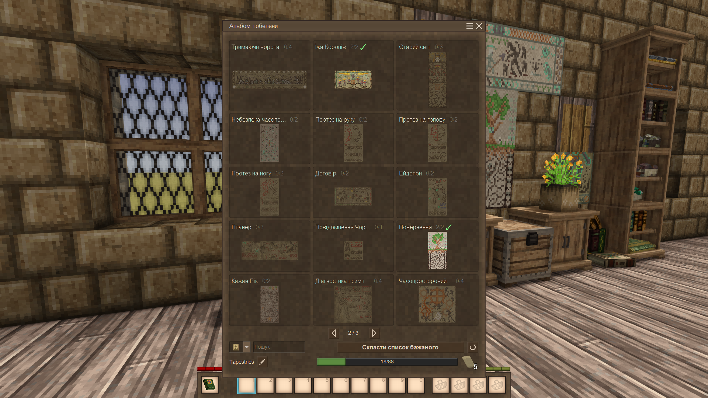
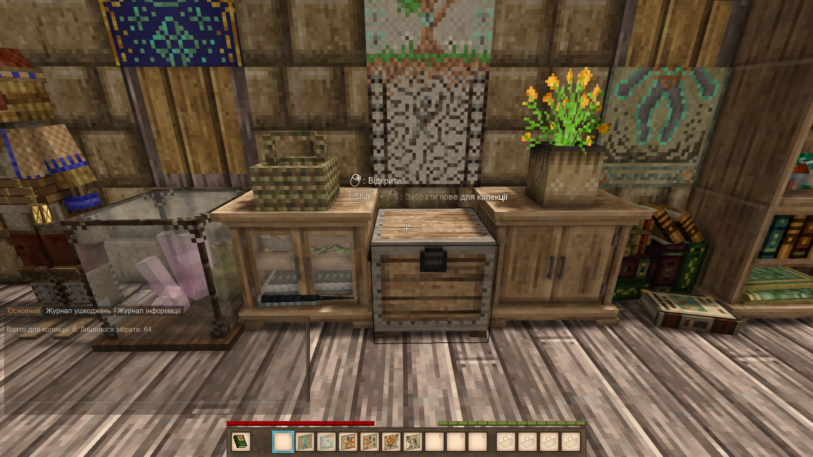
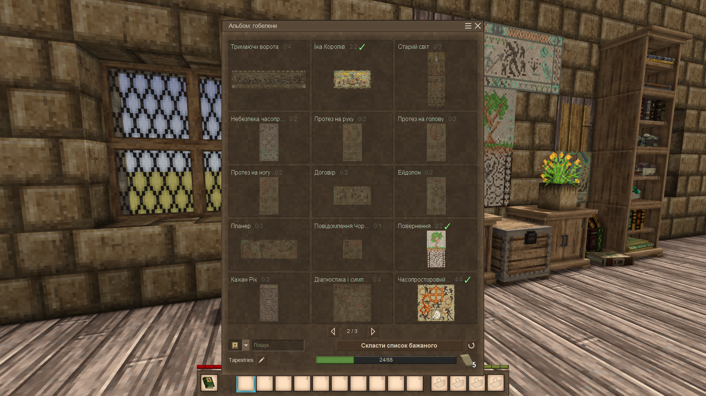
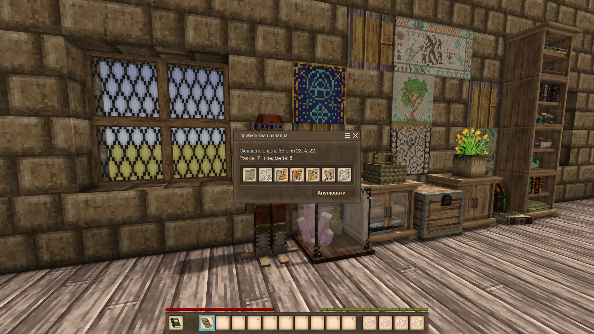

# Каталог дивовиж: посібник

Повний посібник до мода: кожен жест, рецепт, колекція й налаштування. Коротко про мод — на
[сторінці ModDB](https://mods.vintagestory.at/curiocatalogue); коротший посібник для гри є в довіднику гри. English: [README.md](README.md).

Зміст: [Як почати](#як-почати), [Колекції](#колекції), [Жести](#жести), [Чесна гра на серверах](#чесна-гра-на-серверах),
[Налаштування](#налаштування), [Сумісність і відомі обмеження](#сумісність-і-відомі-обмеження),
[Видалення мода](#видалення-мода), [Аркуші й обкладинки](#аркуші-й-обкладинки).

## Як почати

1. **Перша книга.** Ванільна книга посередині сітки крафту, цвяхи й смуги над і під нею, перо з чорнилом праворуч: облікова книга
   з 8 аркушами й обкладинкою тієї книги. Написане в тій книзі пропаде. Велику книгу, знайдену в руїнах, можна відновити глечиком
   вапняної води й пером з чорнилом: така книга має 32 аркуші. Облікова книга записує види предметів, список матеріалів — їхню кількість;
   порожня книга сама в сітці крафту стає іншою. Як вони працюють, кажуть їхні сторінки в довіднику.

   

2. **Альбом.** Порожня облікова книга чи список матеріалів і будь-який предмет колекції (шматок гобелена, кристал руди, мушля, мертвий метелик)
   в сітці крафту; предмет лишається. Який предмет ви взяли, така й колекція альбому.
3. **Збирайте.** Тримайте альбом у руці або в другій руці, коли основна порожня, і натисніть **Shift + ПКМ** по скрині.
   Альбом записує те, що взяв; куди ви потім подінете знахідки — ваша справа.
4. **Дивіться.** ПКМ у повітря відкриває альбом сторінками: кожна картина зі своїми шматками на місцях, наявні й бракуючі
   тьмяними силуетами. Гортайте сторінки кнопками або оберіть групу на вкладці; пошук підсвічує збіги. Під заголовком: назва
   альбому (олівець змінює її), смуга зібраного й аркуші, що лишилися для списків бажаного. Кнопка **Скласти список
   бажаного** стоїть у ряду керування. Альбом кристалів руди чи мушель спершу просить вибрати [рівень](#рівні).

У довіднику гри є посібник «Каталог дивовиж» і сторінка для кожної книги.

## Колекції

Альбом збирає одну колекцію, яку визначає предмет, з якого його зроблено.

| Колекція | Робиться з | Рівні | Показано |
|---|---|---|---|
| Гобелени | шматок гобелена | один: 88 шматків у 31 картині | за картинами або за розміром |
| Кристали руди | кристал руди | *Найбагатший кристал кожної руди* (16), *Кожна руда в кожній породі* (117), *Усі кристали* (349) | залежно від рівня, див. [Розкладки](#розкладки) |
| Мушлі | мушля | *Кожен вид* (7), *Кожен вид у кожному кольорі* (42) | залежно від рівня, див. [Розкладки](#розкладки) |
| Метелики | мертвий метелик | один: усі 169 (109 видів) | за родинами або за рідкістю |

### Рівні

Рівень — це скільки з колекції просить альбом. Новий альбом кристалів руди чи мушель рівня ще не має: його вікно каже «Виберіть
рівень, щоб почати збирати», і доки ви не виберете рівень у списку рівнів, альбом нічого не бере й не складає списків бажаного.
Перший забраний предмет закріплює рівень; щоб вибрати інший, натисніть **Почати заново**, і все знову стане «бракує».

- *Найбагатший кристал кожної руди:* по кристалу кожної руди найбагатшої якості, з будь-якої породи.
- *Кожна руда в кожній породі:* кожна руда в кожній породі, де вона трапляється, найбагатшої якості.
- *Усі кристали:* кожна якість кожної руди в кожній породі.
- *Кожен вид:* по мушлі кожного виду, будь-якого кольору.
- *Кожен вид у кожному кольорі:* кожен вид у кожному з шести його кольорів.

### Розкладки

Розкладка — це те, як альбом розкладає предмети на сторінках. Де рівень можна показати по-різному, список розкладок будь-коли
перемикає вигляд; зібране від цього не змінюється.

- Гобелени: **за картинами**, рамка для кожної картини зі шматками на своїх місцях, або **за розміром**, ті самі рамки на
  вкладці для кожного розміру картини, від найменшого: 1×1, 2×1, 1×2, 3×1, 1×3, 2×2, 4×1 (ширина × висота, у шматках).
- Кристали руди: *Найбагатший кристал кожної руди* — одна сторінка з 16 кристалів; *Кожна руда в кожній породі* — одна
  таблиця руд за породами; *Усі кристали* показано **за рудами**, таблицею якостей за породами для кожної руди, або **за
  породами**, таблицею якостей за рудами для кожної породи.
- Мушлі: *Кожен вид* — одна сторінка з 7 мушель; *Кожен вид у кожному кольорі* — одна таблиця видів за кольорами. Водянисте й
  бірюзове забарвлення, рідкісні кольори гри, мають маленький золотий кутик і «Рідкісний колір» у підказці.
- Метелики: **за родинами**, сім вкладок (нічні метелики однією) з рамкою для кожного зі 109 видів під його латинською назвою,
  або **за рідкістю**, шість вкладок за тим, як часто гра їх породжує, від легендарних до звичайних.

Таблиці підписано іконками: руду — її самородком, якість — круглою жовтою позначкою, що росте й яскравішає з нею, породу — її
каменем, колір мушлі — круглим зразком кольору. Наведіть на іконку, щоб побачити назву. Найбагатша якість — верхній рядок;
порожнє місце в таблиці — кристал, якого гра ніколи не породжує.

### Назви й «будь-який»

Підказка над клітинкою альбому й кожен рядок списку бажаного називають те, чого бракує, тим, що воно є: «Засідка, ліва
третина» для шматка гобелена, «Самородна мідь, щедра, базальт» для кристала; метелики зберігають власні назви гри. Де
згодиться кілька предметів, назва так і каже («Самородна мідь, будь-якої породи», «Гребінець, будь-якого кольору»); клітинка
показує ці предмети по черзі, а альбом чи список бажаного бере той, для якого є місце.

Метелики на полицях, у вітринах і в модах-вітринах поки не зчитуються: спершу покладіть їх у скриню. Те саме з гобеленами на
стіні.

## Жести

З книгою в руці або в другій руці, коли основна порожня:

- **Shift + ПКМ** по контейнеру: альбом забирає нове для колекції; облікова книга чи список матеріалів складає прибуткову накладну
  на те, чого в книзі немає.
- **Shift + Ctrl + ПКМ** по контейнеру: видаткова накладна на те, що в книзі є.
- **ПКМ у повітря:** відкриває книгу.

З накладною в руці **Shift + ПКМ** по будь-якому контейнеру проводить її. Якщо книга в другій руці, вона оновиться й отримає
аркуш назад (альбом лише аркуш); без неї накладна стане пергаментом. Список бажаного проводиться так само: забирає те,
що в ньому є, а виконаний стає пергаментом.

Звичайні ПКМ і Ctrl + ПКМ відкривають контейнери, як завжди.

## Чесна гра на серверах

- Вирішує сервер. Накладна переносить усе, що в ній записано, або нічого, і каже, що завадило.
- Доступу не більше, ніж руками: приватні зони, замки й укріплення діють на кожну дію, як на відкриття скрині.
- Жодного віддаленого доступу: предмети переносяться лише з того контейнера, по якому ви натиснули.

## Налаштування

`ModConfig/curiocatalogue.json`:

- `MaxSheets` (32): скільки аркушів уміщує книга.
- `SoftEntryLimit` (500): книга з такою кількістю записів більше не складає прибуткових накладних.
- `ConsumeSheets` (false): хардкор; проведена накладна ніколи не повертає аркуш.
- `ExtraIgnoredAttributes` (`["durability"]`): атрибути, які не враховуються при порівнянні предметів, на додачу до ігрових.
- `Collections`: налаштування кожної колекції за її id (`tapestries`, `crystals`, `seashells`, `butterflies`): `Exclude` (назви, які прибрати, `*` — довільний текст: `type` шматка гобелена (не назва, яку показує альбом), напр. `["aid-*"]`, або код предмета без `game:`, напр. `["crystalizedore-*-uranium-*"]`), `Add` (додаткові шматки гобеленів з інших модів) і `Disabled` (вимкнути колекцію: її альбоми зберігають зібране й нічого не беруть, доки її не ввімкнуть знову). Старі `TapestryExclude` і `TapestryAdd` з 0.1 переїжджають туди самі під час першого запуску.
- `Diagnostics` (false): писати подробиці в журнал гри, щоб шукати проблеми.

Сервер читає файл під час запуску.

Сервер надсилає свої `Collections` і `ExtraIgnoredAttributes` кожному клієнтові під час входу, тож альбом і підказки слідують файлу сервера, а не клієнта. Решту налаштувань застосовує лише сервер. Мод, що додає колекцію, має стояти на сервері й на кожному клієнті: означення читаються з власних ресурсів кожної сторони.

## Сумісність і відомі обмеження

- Потрібна Vintage Story 1.22.7. Встановіть мод на сервер і на кожен клієнт.
- Моди, що додають гобелени до ігрового списку гобеленів, альбом підхоплює; руди, мушлі й метеликів з інших модів — ні.
- Перевірено з Upgradeable Storage і Carry On.
- **Better Crates** не підтримується: його ящики відмовляють нашим накладним і показують накладні й книги неправильно (темними, розвернутими).
- Наші книги й накладні не кладуться у ванільний ящик: Shift + ПКМ по контейнеру — наш жест.
- З увімкненим `ConsumeSheets` слова довідника «аркуш повертається» не діють.
- Підтримувані контейнери: скрині, великі дерев'яні скрині, скрині з табличкою, кошики, посудини для зберігання, ванільні ящики, рюкзаки
  й кошики, поставлені на землю, а також скрині інших модів, зроблені на основі ванільних. На інші блоки з інвентарем (печі,
  бочки, полиці…) мод каже «Цей контейнер поки не підтримується». Персональні скрині зі здобиччю в руїнах відмовляють.
  Якщо так каже контейнер іншого мода, напишіть нам назву мода й блоку: див. [CONTRIBUTING.md](../../CONTRIBUTING.md).

## Видалення мода

Гра видаляє предмети мода, якого вже немає. Без «Каталогу дивовиж» усі книги й накладні зникнуть з інвентарів і скринь разом
з аркушами в них; повторне встановлення мода їх не поверне. Щоб прибрати лише одну колекцію, вимкніть її через `Disabled`.

## Аркуші й обкладинки

Кожна накладна й кожен список бажаного коштує аркуш. Накладну чи список бажаного можна анулювати в їхньому вікні: предмети лишаться
на місці, а аркуш повернеться в книгу в другій руці; без книги накладна чи список стане пергаментом. Додавайте аркуші пергаментом
у сітці крафту, до ліміту (типово 32). Фарбована шкіра перефарбовує книгу, а глечик сірчаної кислоти старить обкладинку.
