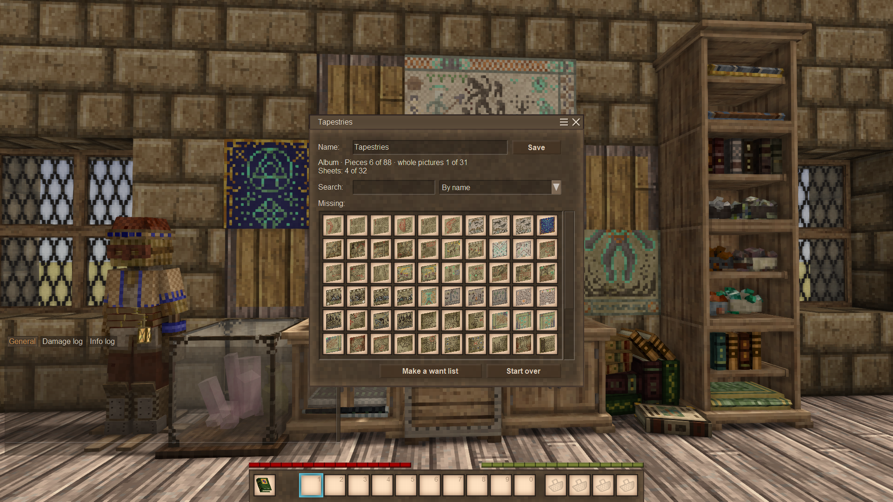
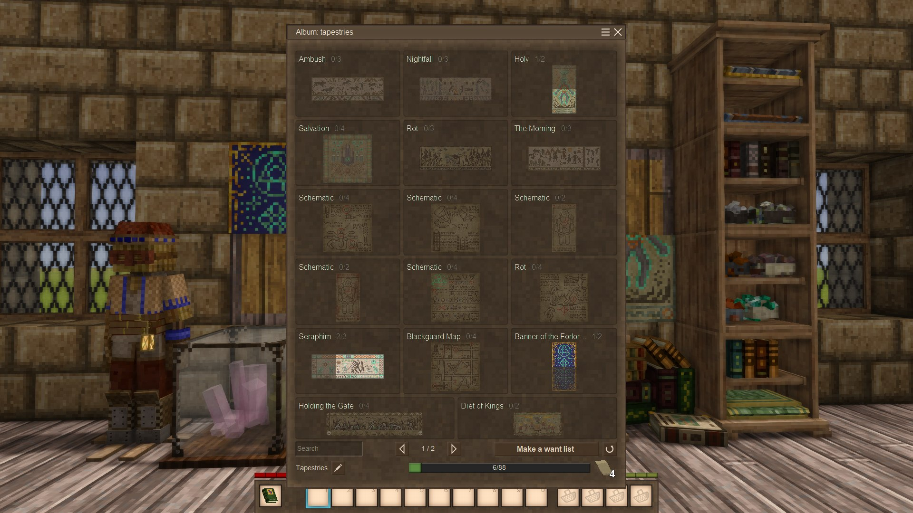
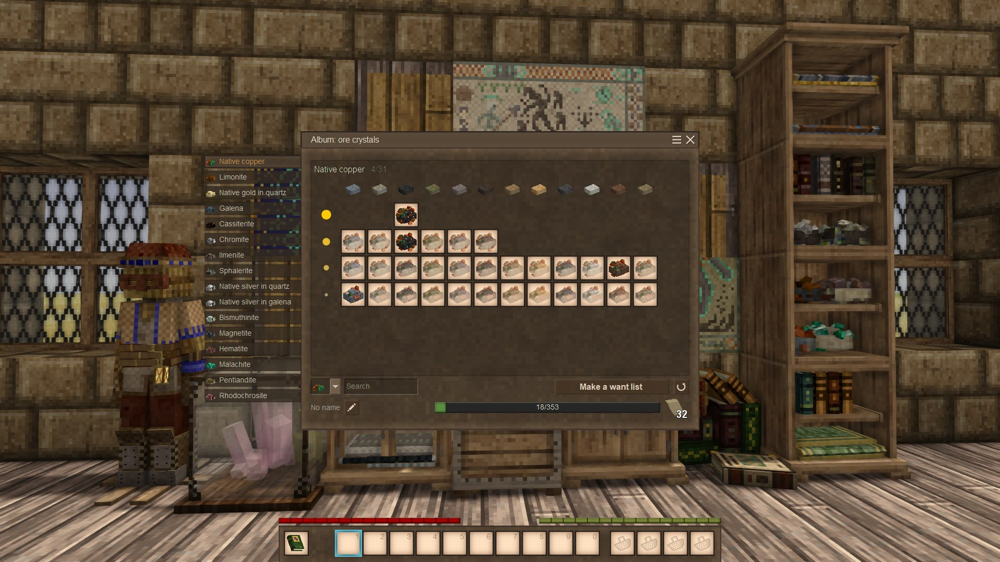
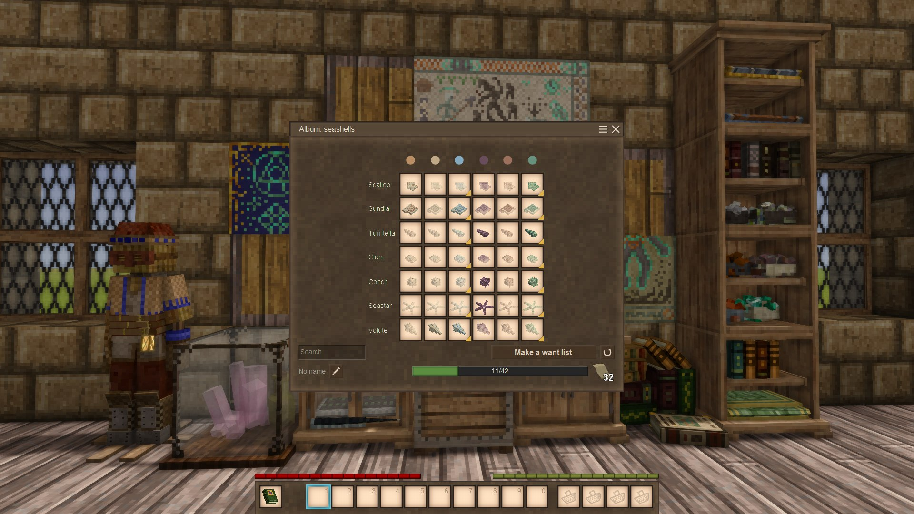
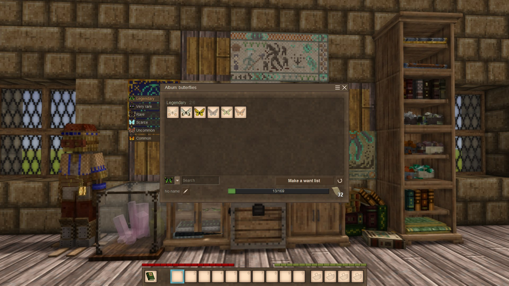

# Curio Catalogue

A Vintage Story mod about collecting and keeping account of things, in the spirit of an old counting house.

> **Early development.** This is 0.1.1, still a minimal version of the mod (an MVP). Try it in a test world first.
> The way books and lists store their data may change in the next two releases, and books and lists made with this
> version may not carry over.
>
> **Back up your world** before installing the mod or a new version of it.

## What's new

New in 0.2 (a draft: the release plan rewrites it):

- **Four collections, not one:** tapestries, ore crystals, seashells and butterflies; each album collects the one it was made from.
- **The album is a catalogue of pages:** every picture with its pieces in place, what you have and the missing ones as dim silhouettes.
- **Albums remember what they collected,** piece by piece; albums of 0.1 are converted when first read, with nothing lost.
- **Want lists name what is missing** ("Native copper, any rock") and take any item that will do.

## What's inside

- **The album:** a collector's catalogue that knows what you are still missing, and takes one of each missing piece from a chest. Four collections: tapestries (88 pieces in 31 pictures), ore crystals, seashells (42) and butterflies (169); see "Collections" below.
- **The want list:** made by the album; give it to a friend and it gathers what you miss from their chests.
- **The ledger:** a book that notes which kinds of items you have, by type.
- **The bill of materials:** a book that notes how many of each, a shopping list for a project that shrinks as you take what you need from chests.
- **The intake list:** what a chest has that the book lacks; fill it from the chest and the items move into your inventory.
- **The pick list:** what a chest has of the book's entries; it moves them all, or none.

Books and lists are ordinary items. They hold their data themselves, so you can hand them over, put them on a shelf or lose them.

## Collections

An album collects one collection, chosen by the piece it is made from.

| Collection | Made from | Levels |
|---|---|---|
| Tapestries | a tapestry piece | one: 88 pieces in 31 pictures |
| Ore crystals | an ore crystal | the richest crystal of each ore (16); each ore in each rock (118); every crystal (353) |
| Seashells | a seashell | every type in any colour (7); every type in every colour (42) |
| Butterflies | a dead butterfly | one: all 169, shown by family and species (109) or by rarity |

::: sequence collections

Tapestries: the pictures, each with its pieces.

Ore crystals: every crystal, an ore at a time.

Seashells: every type in every colour.

Butterflies: by rarity.

:::

The levels, the rules and what a want list says: see [the guide's section on collections](../guide/README.md#collections).

## What it does not do

- **No remote access, no storage network.** Items move only where you stand: you walk to the chest, click it and see the items move.
- **No automatic sorting.** You decide what goes where; the books help to see and to move.
- **No prices.** Trading stays between players; the mod only makes carrying things easier and more tangible.

## Similar mods

Curio Catalogue is about collections you keep and carry by hand: books and lists are items, and you walk to the chest and see the items move. Other mods overlap with it a little; if one suits you better, use it.

- **[Infinitum Collections](https://mods.vintagestory.at/infinitumcollections)** by unicorn_ares is a journal of discoveries (fish,
  mushrooms, butterflies) with links to the handbook. Curio Catalogue's album tracks what you actually keep, in chests or on
  display, and takes the missing pieces from there. It also makes want lists for other players.
- **[Bookkeeper](https://mods.vintagestory.at/show/mod/43155)** and **[Quartermaster](https://mods.vintagestory.at/show/mod/57459)**
  by Feyd manage storage: finding items in nearby containers and, with Quartermaster, taking and depositing them remotely. They
  care about what is stored, not about what is missing from a collection.

Thanks to these authors: their work makes the game's mod community richer.

## Credits

- Thanks to Anego Studios for Vintage Story, and for opening the code of its API and of the survival mod: it taught us how the
  game works.
- Thanks to the [Fendragon server](https://discord.gg/2yNGvKcRP), where the author collects the very tapestries this mod was made for.
- Thanks to Jeff Walker for [ExhaustiveMatching](https://github.com/WalkerCodeRanger/ExhaustiveMatching) (BSD-3-Clause), which turns a missed
  `switch` case into a compile error. It is used only when building; the mod zip holds none of its code.

### AI and human work

- **Direction:** human. DankoSedin decides what the mod is, what it does and what it will not do.
- **Code:** written by AI (Claude, Anthropic) within a framework of tests and documentation.
- **Texts and translations:** everything the player reads, in English and Ukrainian, is written by AI under close human supervision.
- **Assets:** item textures are drawn by script; the book shape and the mod icon are based on the game's own assets.

## License

MIT, except a few files derived from Vintage Story: see `LICENSE`.
