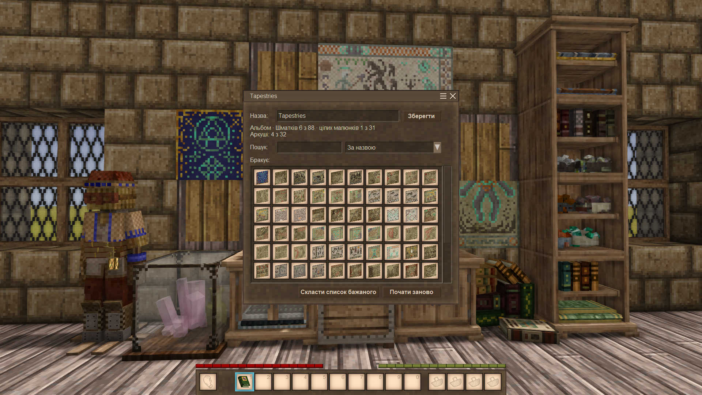
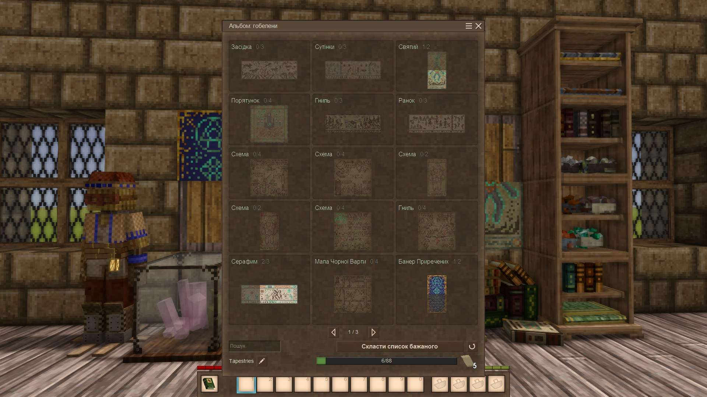
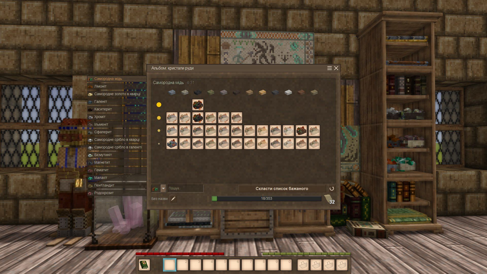
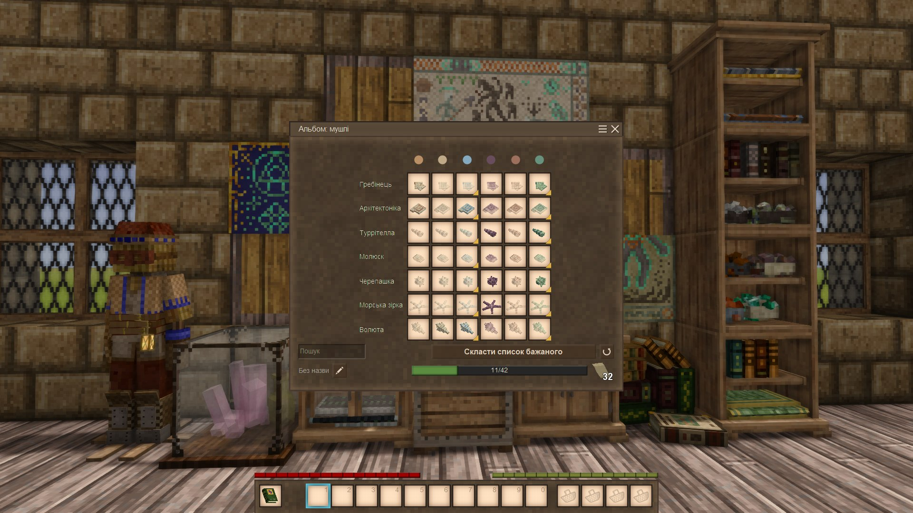
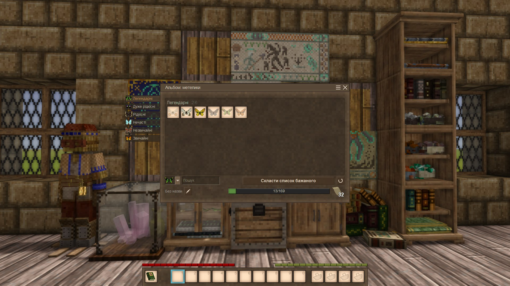

# Каталог дивовиж

Мод для Vintage Story про колекціонування й облік речей у дусі старої контори.

> **Рання стадія розробки.** Це 0.1.1, ще мінімальна версія мода (MVP). Спершу спробуйте його в тестовому світі.
> Спосіб, у який книги й накладні зберігають дані, може змінитися в наступних двох релізах, і книги та накладні, зроблені цією
> версією, можуть не перейти на нову.
>
> **Зробіть резервну копію світу** перед встановленням мода чи його нової версії.

## Що нового

Нове в 0.2 (чернетка: її перепише план релізу):

- **Чотири колекції замість однієї:** гобелени, кристали руди, мушлі й метелики; кожен альбом збирає ту, з якої його зроблено.
- **Альбом — каталог зі сторінок:** кожен малюнок зі своїми шматками на місці, те, що є, і відсутнє тьмяними силуетами.
- **Альбоми пам'ятають, що зібрали,** шматок за шматком; альбоми з 0.1 перетворюються при першому читанні, нічого не втрачається.
- **Списки бажаного називають, чого бракує** («Самородна мідь, будь-яка порода»), і беруть будь-який придатний предмет.

## Що всередині

- **Альбом:** каталог колекціонера, що знає, чого вам ще бракує, і забирає зі скрині по одному примірнику кожного відсутнього шматка. Чотири колекції: гобелени (88 шматків, 31 малюнок), кристали руди, мушлі (42) і метелики (169); див. «Колекції» нижче.
- **Список бажаного:** складається в альбомі; віддайте його другові, і він збере зі скринь друга те, чого вам бракує.
- **Облікова книга:** книга, що записує, які предмети є, за видами.
- **Список матеріалів:** книга, що записує, скільки кожного; список покупок для будівництва, що скорочується, поки ви берете потрібне зі скринь.
- **Прибуткова накладна:** те, що є в скрині, а в книзі немає; проведіть її по скрині, і предмети перейдуть у ваш інвентар.
- **Видаткова накладна:** те, що є в скрині з записаного в книзі; переносить усе або нічого.

Книги й накладні — звичайні предмети. Вони самі зберігають свої дані, тож їх можна передати, поставити на полицю чи загубити.

## Колекції

Альбом збирає одну колекцію, яку визначає предмет, з якого його зроблено.

| Колекція | Робиться з | Рівні |
|---|---|---|
| Гобелени | шматок гобелена | один: 88 шматків у 31 малюнку |
| Кристали руди | кристал руди | найбагатший кристал кожної руди (16); кожна руда в кожній породі (118); усі кристали (353) |
| Мушлі | мушля | кожен вид у будь-якому кольорі (7); кожен вид у кожному кольорі (42) |
| Метелики | мертвий метелик | один: усі 169, показані за родинами й видами (109) або за рідкістю |

::: sequence collections

Гобелени: малюнки, кожен зі своїми шматками.

Кристали руди: усі кристали, по одній руді.

Мушлі: кожен вид у кожному кольорі.

Метелики: за рідкістю.

:::

Рівні, правила й що каже список бажаного: див. [розділ посібника про колекції](../guide/README.uk.md#колекції).

## Чого він не робить

- **Жодного віддаленого доступу й мережі сховищ.** Предмети переносяться лише там, де ви стоїте: ви йдете до скрині, натискаєте її й бачите, як предмети переходять.
- **Жодного автоматичного сортування.** Ви вирішуєте, що куди йде; книги допомагають бачити й переносити.
- **Жодних цін.** Торгівля лишається між гравцями; мод лише робить перенесення речей легшим і відчутнішим.

## Схожі моди

«Каталог дивовиж» — про колекції, які ви зберігаєте й носите в руках: книги й накладні — предмети, ви йдете до скрині й бачите, як предмети переходять. Інші моди дещо перетинаються з ним; якщо котрийсь вам підходить більше, користуйтеся ним.

- **[Infinitum Collections](https://mods.vintagestory.at/infinitumcollections)** від unicorn_ares — журнал відкриттів (риби, гриби,
  метелики) з посиланнями на довідник. Альбом Curio Catalogue веде облік того, що ви справді зберігаєте, у скринях чи на виставці,
  і бере звідти те, чого бракує. Ще він робить списки бажаного для інших гравців.
- **[Bookkeeper](https://mods.vintagestory.at/show/mod/43155)** і **[Quartermaster](https://mods.vintagestory.at/show/mod/57459)**
  від Feyd керують сховищами: шукають предмети в сусідніх контейнерах, а Quartermaster ще й бере та складає їх віддалено. Їх
  цікавить, що лежить у сховищах, а не чого бракує колекції.

Дякуємо цим авторам: їхня праця робить спільноту модів гри багатшою.

## Автори й подяки

- Дякуємо Anego Studios за Vintage Story і за відкритий код її API та модуля виживання: з нього ми дізналися, як працює гра.
- Дякуємо [серверу Fendragon](https://discord.gg/2yNGvKcRP), де автор збирає ті самі гобелени, для яких зроблено цей мод.
- Дякуємо Jeff Walker за [ExhaustiveMatching](https://github.com/WalkerCodeRanger/ExhaustiveMatching) (BSD-3-Clause): вона перетворює
  пропущений `case` у `switch` на помилку компіляції. Вона потрібна лише під час збирання; у зіпі мода її коду немає.

### ШІ та людина

- **Напрямок:** людина. DankoSedin вирішує, що це за мод, що він робить і чого не робитиме.
- **Код:** пише ШІ (Claude, Anthropic) у рамках тестів і документації.
- **Тексти й переклад:** усе, що читає гравець, англійською та українською, пише ШІ під пильним наглядом людини.
- **Асети:** текстури предметів намальовані скриптом; форма книги й іконка мода створені на основі асетів самої гри.

## Ліцензія

MIT, крім кількох файлів, похідних від Vintage Story: див. `LICENSE`.
